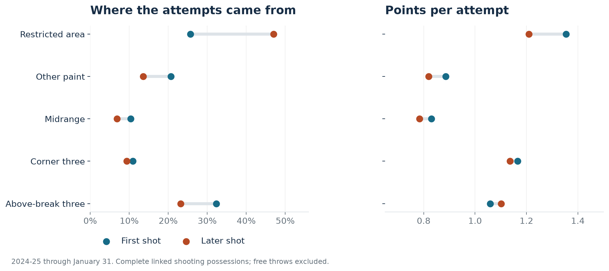

# Basketball decisions, checked against later games

[Read the basketball decision brief](reports/00_decision_brief.md) · [Visual design and rebuild](tools/VISUALS.md)

Three research studies on shot creation, opponent scouting, and shooting forecasts. The analyses use 657,388 NBA shot-chart events across the 2023-24, 2024-25, and 2025-26 regular seasons, plus 2024-25 possession data. Research completed September 2026.

| Study | Basketball question | Main result |
|---|---|---|
| [After the miss](reports/01_after_the_miss.md) | Are later shots in a possession better than the first? | The rim share rises sharply, but the scoring difference is only +0.9 points per 100 attempts; its interval includes zero. |
| [Three-point defense](reports/02_three_point_defense.md) | Should an early opponent percentage carry into the next scouting report? | A shooter-and-location baseline beats the raw percentage on later attempts. The selected team-residual correction is effectively zero. |
| [Updating a shooter](reports/03_when_to_update_a_shooter.md) | How far should a hot start move a shooting forecast? | A Bayesian update beats the early percentage; its improvement over previous history is much smaller. |

The first study covers October 2024-January 2025 because later possession linkage is incomplete. The forecasting studies evaluate 2025-26 after development on earlier seasons. Every article states its denominator, time window, and practical limits.



## Reproduce

Use Python 3.12. From this directory:

```bash
python -m venv .venv
source .venv/bin/activate
pip install -r requirements.txt
python -m src.run_all --fetch
python -m unittest discover -s tests -v
```

On Windows, activate with `.venv\Scripts\activate`. Downloads require internet access; analysis runs locally after the data is cached. Raw inputs are about 260 MB after extraction. Download URLs are pinned to a repository commit, and SHA-256 checks reject changed archives. The archive files and raw CSVs are excluded from Git.

The three notebooks can be opened after setup. They rerun their study, display the actual results, and expose calculations useful for review. Committed notebooks include executed outputs. To rerun all notebooks with the current environment:

```bash
python -m src.notebooks
```

## Contents

- `reports/`: three articles in Markdown and self-contained HTML.
- `notebooks/`: executed research notebooks.
- `src/`: data preparation, statistical models, chart generation, and publishing utilities.
- `sql/`: indexed team summaries and a player-history window that excludes the current outcome.
- `results/`: full tables, tuning grids, uncertainty estimates, and monitoring output.
- `models/`: readable fitted parameters and model scope.
- `figures/`: nine figures in PNG and SVG.
- `tests/`: scoring, linkage, leakage, posterior, SQL, and output checks.

A manually triggered GitHub workflow downloads the pinned inputs, reruns the research and runs the checks.

## Read the results correctly

The second-shot comparison is descriptive. It does not estimate the net value of sending another rebounder, and it excludes free-throw points. The defense model is conditional on observed shot context and cannot identify pure defensive skill or shooting luck. The shooter study is a historical backtest with a fixed cutoff, not a record of forecasts published at the time.

The forecast models are validated research implementations. They have not been operated inside a basketball organization. Monitoring examples and saved parameters demonstrate how the work can be inspected and maintained without claiming proprietary data or production deployment.

See [methods and data notes](METHODS.md) for definitions, checks, and source limitations.

## Data credit

Input collection: [shufinskiy/nba_data](https://github.com/shufinskiy/nba_data), originating from NBA shot charts and pbpstats possession processing. Pinned revision: `e829d4678be1e075f99e5d41a1c5f97089be446b`. The upstream repository is marked Apache-2.0; underlying NBA material retains its applicable rights. No raw video is redistributed. New analysis code is MIT licensed; that license does not grant rights to third-party data or video.

## Current review

See [current validation](VALIDATION_CURRENT.md) for executed checks and unresolved rebuild requirements, and [provenance](PROVENANCE.md) for AI assistance. [Portfolio navigation](https://github.com/jmsmarrelli/basketball-analytics).
