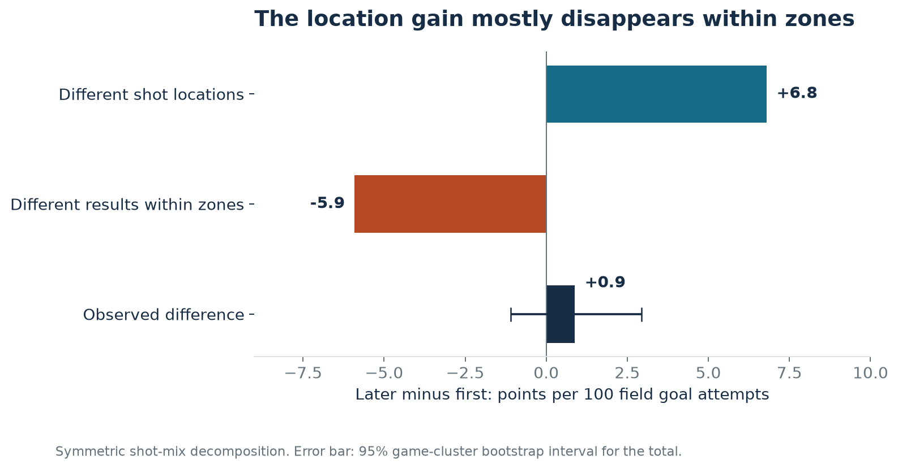
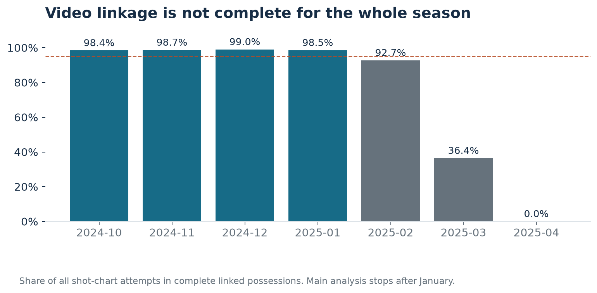

# After the miss: the shot mix changes more than the scoring rate

Joseph Smarrelli · September 2026

An offensive rebound keeps an offense alive. Whether the next shot is better than the first is a separate question.

In 124,786 linked field goal attempts from October 22, 2024 through January 31, 2025, later attempts were much more likely to come from the restricted area. They produced **1.095 points per attempt**, compared with **1.086 on first attempts**. The difference was only **0.9 points per 100 attempts**, with a 95% game-cluster interval from **-1.1 to +2.9**.

That result supports a specific distinction for a coaching discussion: gaining another attempt is valuable even when that attempt is not unusually efficient. It does not establish how many players should crash the glass.

## Define the comparison before counting

The unit here is a field goal attempt within a linked shooting possession. A first attempt is the earliest shot-chart event in that possession. A later attempt follows it in the same possession, and the possession must contain enough offensive rebounds to account for its additional attempts. Possessions with incomplete shot linkage are excluded. This avoids treating a partially observed possession as if its first visible shot were its first actual shot.

The analysis contains **109,662 first attempts and 15,124 later attempts across 709 games**. Free throws contribute no points to this comparison. Turnover-only possessions are outside the denominator. A first field goal can follow a missed free throw; the phase label tracks field-goal order, not the official first- or second-chance designation. These are points per field goal attempt, not offensive rating or official second-chance points.

The restricted-area share rose from **25.7% to 47.0%**. Three-point share fell from **43.3% to 32.5%**. The larger rim share is consistent with the opportunities an offensive rebound can create, but the result within a location matters too. A putback in traffic and an uncontested finish can occupy the same zone.

## Separate the location mix from results within each zone

A symmetric decomposition splits the overall scoring difference into two components. For zone z, let w be its share of attempts and p its points per attempt. Subscripts F and L denote first and later shots:

- Location component: sum of `(wL - wF) × (pL + pF) / 2`.
- Within-zone component: sum of `(pL - pF) × (wL + wF) / 2`.

The components add exactly to the observed difference. The symmetric form avoids making either shot group the privileged reference.

The location component contributed **+6.8 points per 100 attempts**. Results within zones contributed **-5.9**, leaving the small net difference. These components are descriptive accounting. They are not causal estimates of moving a shot or choosing to attempt a putback.

The comparison also changes who is shooting, how much space is available, and which misses were recoverable. No adjustment here makes those groups exchangeable. The lower restricted-area scoring rate on later attempts should prompt film review of traffic, balance, and available outlets; it should not become an instruction to pass up every putback.

## The coverage problem changed the study window

The possession source contained 483,126 video-event rows but only 243,782 distinct possessions. Counting the rows directly would have inflated possession totals. After deduplication, the event identifier in each video URL provided a link to the NBA shot-chart event.

Coverage then revealed a more consequential problem: the video linkage deteriorated late in the season. The full-season match rate was about 77%, with no linked attempts in April. The main analysis therefore uses the last contiguous run of months with at least 95% coverage: October through January. Within that window, **98.7% of shot-chart attempts** are retained. The cutoff follows coverage, not the estimated scoring difference.

Six attempts had a shot-value and zone-label disagreement. They remain in the total and enter the decomposition as unclassified. The full-season possession feed also contains 727 fewer attempts than the shot-chart feed. Those source differences are recorded rather than silently forced to match.

A sensitivity sample excludes shots in the final 24 seconds of a period and possessions beginning with a score margin greater than 15 points. First attempts produced **1.093 points per attempt**; later attempts produced **1.097**. The conclusion remains a small descriptive difference. The 2,000 bootstrap resamples draw whole games jointly, preserving the dependence between first and later shots within each game.

## What belongs in the staff conversation

Use the result to separate the value of extending a possession from the quality of the next attempt. Review the rebounder's immediate options: finish, gather, or pass out. The accompanying film queue identifies game, period, clock, and shot event for examples involving Phoenix, San Antonio, and New Orleans. It is a review queue, not a claim that those clips have already been evaluated.

A decision about sending another player to the glass requires data this study does not contain: who crashed, who retreated, rebounding opportunity, opponent numbers in transition, and the next defensive possession. That is the next measurement task before recommending a scheme change. The completed analysis answers the narrower shot-composition question.

## Data and reproducibility

The [NBA data archive maintained by shufinskiy](https://github.com/shufinskiy/nba_data) supplies the shot-chart and possession files. The [possession definitions](https://pbpstats.readthedocs.io/en/latest/pbpstats.resources.possessions.html) describe the upstream possession resource. The repository pins the archive revision and verifies download hashes.

Run `python -m src.second_shots` from the repository root. The notebook exposes the sample checks, phase comparison, decomposition, and review queue. Full estimates are in `results/second_shot_*.csv`; the row-level derived audit is in `data/second_shots_audit.csv.gz`.
