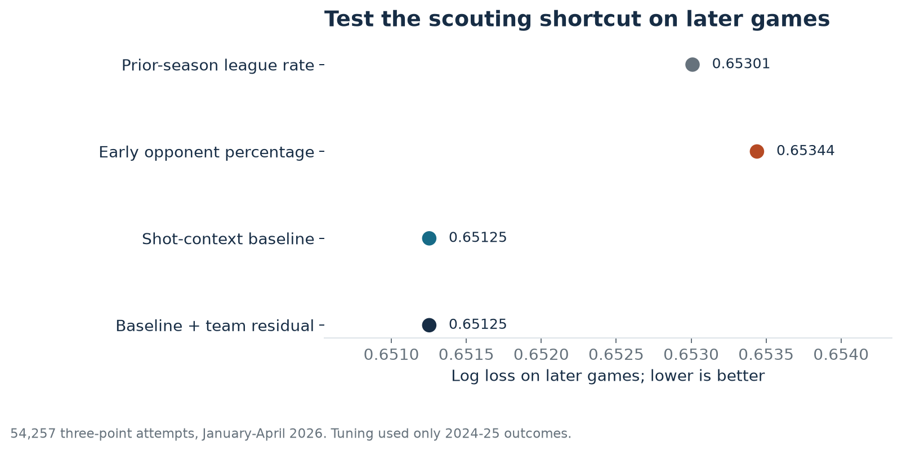
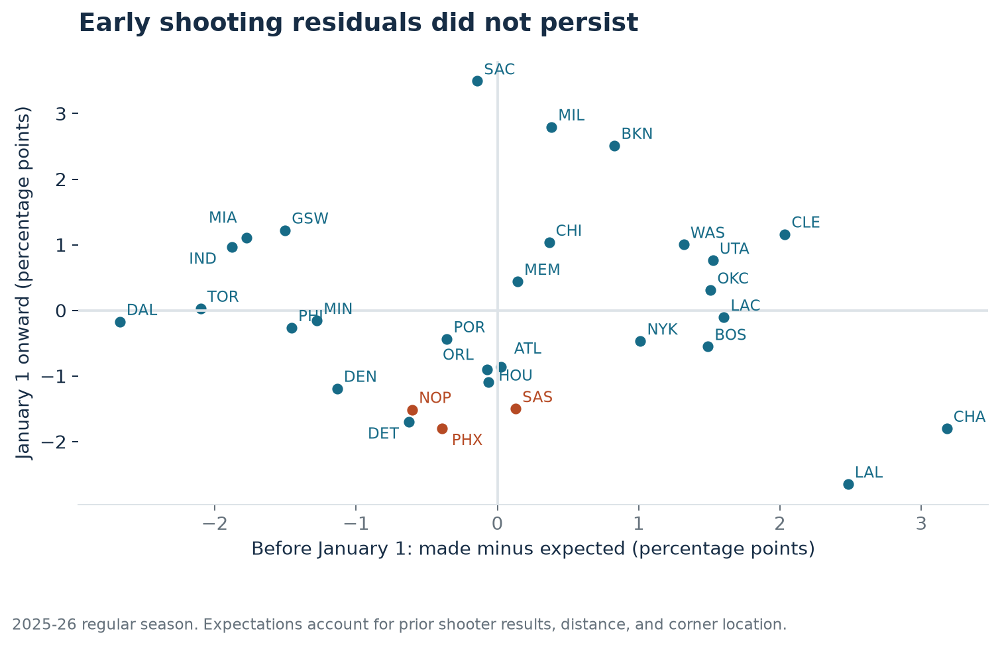
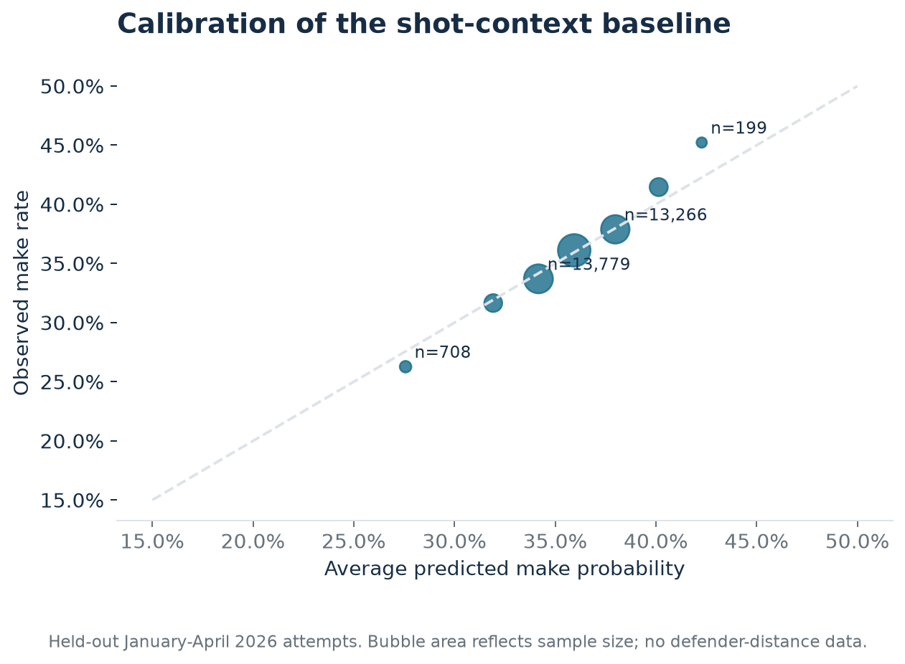

# Before calling it three-point defense, test what carries forward

Joseph Smarrelli · September 2026

An opponent's early three-point percentage is an easy number to put in a scouting report. This study asks whether that number helps predict the attempts the team will face later, after accounting for who is shooting and where.

In the 2025-26 historical backtest, a shooter-and-location baseline performed better than carrying forward each defense's early opponent percentage. Across **54,257 later attempts**, log loss was **0.65125 for the baseline** and **0.65344 for the early-percentage shortcut**. Lower is better. The estimated improvement was 0.00219, with a 95% game-cluster interval of 0.00173 to 0.00269.

The practical recommendation is to show an opponent's three-point rate beside the shooters and locations it allowed. A low percentage by itself is weak evidence for a repeatable defensive advantage in this test.

## A baseline with information that can be inspected

The data contains all 1,230 regular-season games in each season from 2023-24 through 2025-26. The model uses three-point attempts shorter than 40 feet. That rule excludes 50 attempts in the test season and keeps most end-of-period heaves from dominating distance effects.

Each attempt receives four inputs:

1. The shooter's previous-season three-point rate, shrunk toward the previous-season league rate with 80 pseudo-attempts, then transformed to log odds.
2. A corner-three indicator.
3. Shot distance, clipped to the 20-39 foot range.
4. Squared distance, allowing a curved distance relationship.

A regularized logistic regression estimates make probability. Unknown or new shooters receive the league prior. Features are standardized using the fitting sample only. Shooter identity is represented through prior results, not through a lookup of test-season makes.

The expectation is conditional on an observed attempt. The model does not know the future shot mix before a game. It should not be described as a pregame forecast of team shooting percentage or a tracking-based shot-quality model.

## Keep model selection out of the test season

The development season is 2024-25. Games before January 1 fit candidate models, while later games select regularization and the amount of weight to place on an early team residual. The candidate regularization values are 0.01, 0.1, 1, and 10. Team-residual shrinkage uses 0, 250, 500, 1,000, 2,000, or effectively infinite pseudo-attempts.

For a defense, the early residual is its opponents' observed make rate minus the average baseline expectation. An optional correction multiplies that residual by `n / (n + k)` and adds it to later baseline probabilities. This is a deliberately simple test of whether the early discrepancy deserves weight.

Development selected **C = 0.1 and effectively zero weight on the team residual**. The baseline was then refit on the entire development season. All 2025-26 evaluation uses that fitted baseline and the already selected settings. The January 1, 2026 split supplies 36,663 early attempts and 54,257 later attempts.

The prior-season league rate scored 0.65301, also better than the raw early-opponent-percentage shortcut. The shot-context baseline improved on the league rate by 0.00176 in log loss; the game-cluster interval was 0.00135 to 0.00220. The team-residual version is effectively identical to the baseline because development selected near-total shrinkage. This is a useful negative result, rather than evidence that adding a team term always helps.

## Does the discrepancy persist across teams?

The correlation between early and later raw opponent percentages was **-0.083** across 30 teams. The correlation between early and later baseline residuals was **-0.097**.

These are descriptive correlations from one season. They do not prove that defenses cannot affect shooting. A residual combines unmeasured contest quality, shot-clock pressure, shooter form, scheme, and randomness. The model does not observe defender distance, rotations, screen coverage, or how a shooter reached the attempt. Labeling its residual “luck” would assign a cause the data cannot identify.

The game-cluster uncertainty intervals in the exported team table are marginal intervals. They are not adjusted for selecting the most extreme of 30 teams. A small interval excluding zero for one team is not a sufficient reason to declare a defensive skill.

## Check probability quality, not just ranking

The calibration plot groups later attempts by predicted probability. Most of the volume sits near the diagonal, while the highest-probability group is small. Brier scores, bin counts, and monthly observed-minus-expected rates are also exported.

Monthly monitoring flags an absolute calibration difference above 2.5 percentage points for review. This is an operational threshold, not a statistical test. No month crossed it in the held-out January-April period. A real recurring report should also inspect missing players, changed data definitions, and the distribution of shot distances before interpreting a drift flag.

## How the scouting report should change

Keep the raw percentage visible, but pair it with corner share, the identities of the allowed shooters, and the model expectation. If a team has a large negative residual, use that as a film-review question: are its closeouts changing the attempts, or are opponents missing shots the staff would accept again?

For the Suns, Spurs, and Pelicans, the exported table supplies the early and later attempts, expectations, residuals, and uncertainty. The orange labels simply identify those teams; they do not alter fitting or selection.

The model's coefficients and scaling parameters are stored in readable JSON. Its limits remain substantial: one held-out season, an intentionally small feature set, no possession-level decision model, and conditional rather than pregame prediction. The result is an evaluated baseline for a reporting workflow, not a complete rating of team defense.

## Sources and reproduction

Shot data: [shufinskiy's NBA archive](https://github.com/shufinskiy/nba_data), with [field definitions](https://github.com/shufinskiy/nba_data/blob/main/description_fields.md). The [scikit-learn validation documentation](https://scikit-learn.org/stable/modules/cross_validation.html) explains the separation between fitting, model selection, and final testing.

Run `python -m src.three_point_defense`. Tuning results, held-out scores, calibration, monthly monitoring, and all 30 team estimates are saved in `results/defense_*.csv`.
