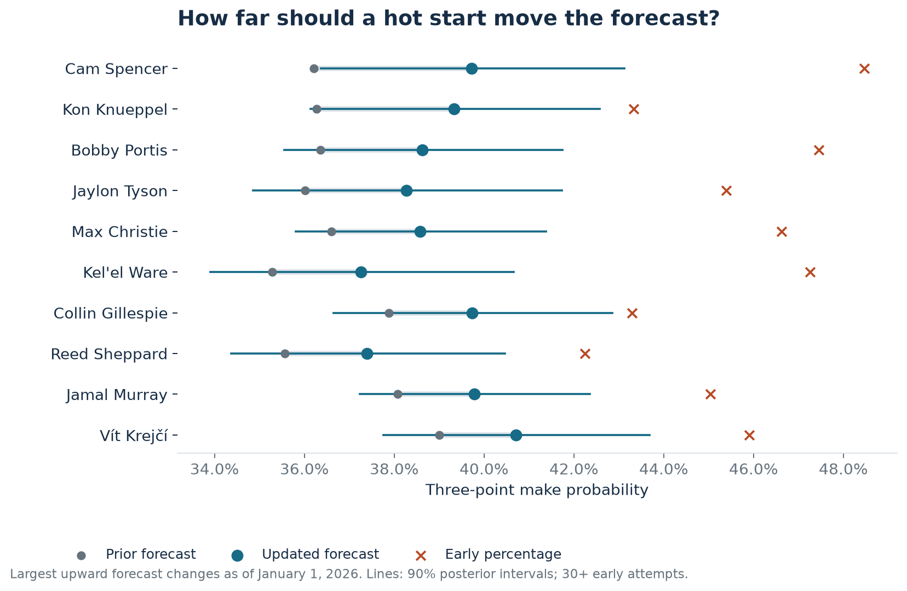
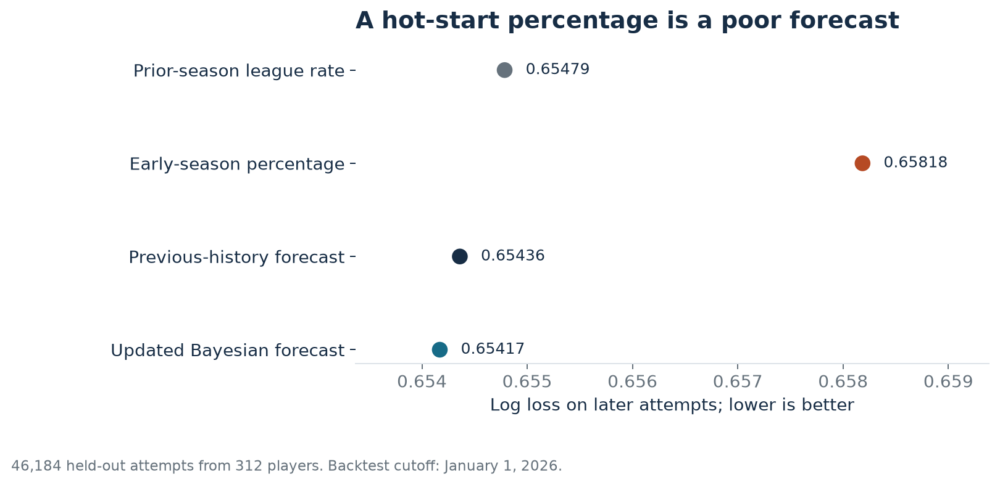
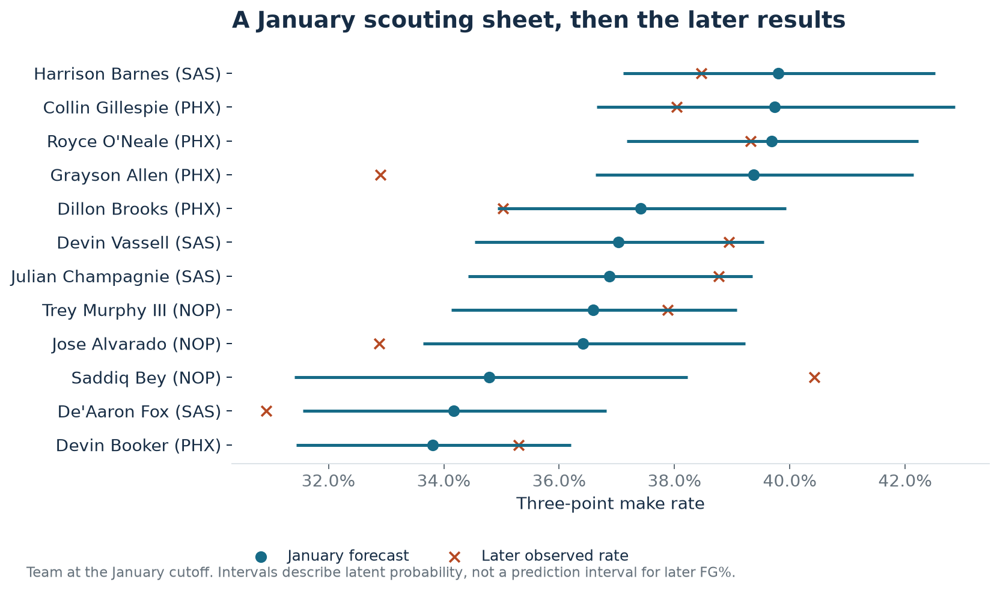

# When should a hot start change the scouting report?

Joseph Smarrelli · September 2026

A player starts the season shooting 43% from three. The staff still needs a working forecast for the next game. Carrying forward 43% treats every early make as if it has settled the question; ignoring the start discards potentially useful information.

This project reconstructs January 1, 2026 forecasts and evaluates the attempts that came afterward. An empirical Bayes update performed better than both the early percentage and a forecast based only on earlier history. The gain over earlier history was small. Most of the improvement came from avoiding an overreaction to the early percentage.

Across **46,184 later attempts from 312 players**, log loss was **0.65417 for the updated forecast**, **0.65436 for the history-only forecast**, and **0.65818 for the early-season percentage**. These are historical backtests built in September 2026, not forecasts claimed to have been published in January.

## Estimate how much evidence an early percentage deserves

The model uses a beta-binomial structure. A league prior describes the distribution of player make probabilities; each player's makes and misses update that prior. The fitted prior uses 2023-24 player totals, excluding attempts from 40 feet or farther.

Maximizing the beta-binomial marginal likelihood gives alpha = **127.88** and beta = **224.73**, equivalent to roughly 353 league-prior attempts. That is substantial pooling. It follows from this model and sample, not a general claim that every shooter needs 353 attempts before anything is learned.

The player's previous-season makes and misses then enter with a discount w. The posterior after early-season results is:

`alpha_post = alpha_league + w × previous_makes + early_makes`

`beta_post = beta_league + w × previous_misses + early_misses`

`forecast = alpha_post / (alpha_post + beta_post)`

The 2024-25 development backtest chooses w from 0, 0.1, 0.25, 0.5, and 1. It selected **1**, retaining all of the previous season's attempts. The prior and discount were fixed before evaluating 2025-26. Players need at least 30 attempts before the January cutoff to enter the forecast sheet; new players start from the league prior.

This chart ranks the largest upward changes using only information before the cutoff. It does not select the players whose later outcomes made the model look best. A wide interval remains wide even when the headline percentage is striking.

For example, Collin Gillespie made **43.3% of 231 early attempts**. The model moved his forecast from **37.9% to 39.7%**. His later rate was **38.0% on 347 attempts**. That example illustrates the size of the update; it is not the evidence for overall model performance. The evaluation includes every eligible player's later attempts.

## Evaluate the forecast, not the story

The development and test seasons use the same January cutoff. The final test contains 315 eligible forecast players, of whom 312 attempted another three. The remaining three are retained in the forecast sheet but have no later outcome to score. There is no minimum future-attempt threshold that silently removes players with limited subsequent roles.

Compared with the early-season percentage, the update reduced log loss by **0.00402**, with a 95% game-cluster interval from **0.00318 to 0.00481**. Compared with the history-only forecast, the gain was **0.00019**, with an interval from **0.00004 to 0.00034**. Resampling whole games accounts for shared game conditions among the evaluated attempts, although it does not capture every form of serial dependence across a player's season.

A second check uses beta-binomial predictive intervals for each player's later made-three count, conditional on the number of later attempts. The nominal 90% intervals covered **93.3%** of evaluated players. That coverage is somewhat conservative and reflects discrete counts. It is different from checking whether a later observed percentage falls inside a posterior interval for latent shooting probability.

The prior parameters are estimated and then treated as fixed. These intervals therefore omit uncertainty in the hyperparameters. They also assume a stable make probability within the modeled period. Role changes, injuries, mechanics changes, and varying shot difficulty can violate that assumption.

## Build a scouting sheet with room for judgment

The team sheet reconstructs forecasts for high-volume players on Phoenix, San Antonio, and New Orleans at the cutoff. Later results appear only as a backtest comparison.

The full export includes the early and prior attempt counts, posterior mean, 90% interval, and change in corner-three share. That last field is a prompt to inspect whether the player is taking different shots. The probability column measures the chance that latent make probability exceeds the **fixed prior forecast plus three percentage points**. It is not the probability of a true year-over-year skill improvement, and it is not a multiple-comparison-adjusted breakout designation.

For a game-preparation meeting, the posterior forecast is a starting estimate. A material rise in forecast or a change in shot profile earns a closer look at how the attempts were created. The result should inform a discussion about how tightly to close out; it should not select a coverage by itself. That decision also depends on driving threat, passing, personnel, and the team's help rules.

A player can finish well above or below the forecast without invalidating the entire method. The relevant checks are aggregate probability quality, calibration, and whether a new piece of basketball information is missing from the model. This small model provides an explicit, tested way to temper an early-season shooting narrative.

## Reproduce and inspect

The [NBA shot-chart archive](https://github.com/shufinskiy/nba_data) supplies the three seasons. The [SciPy beta-binomial documentation](https://docs.scipy.org/doc/scipy/reference/generated/scipy.stats.betabinom.html) defines the predictive distribution used for the made-shot intervals.

Run `python -m src.shooter_updates`. The fitted prior is in `models/shooter_prior.json`; all 315 forecast rows, tuning choices, and evaluation scores are included in the results folder. The notebook also exposes the update calculation for an individual player.
